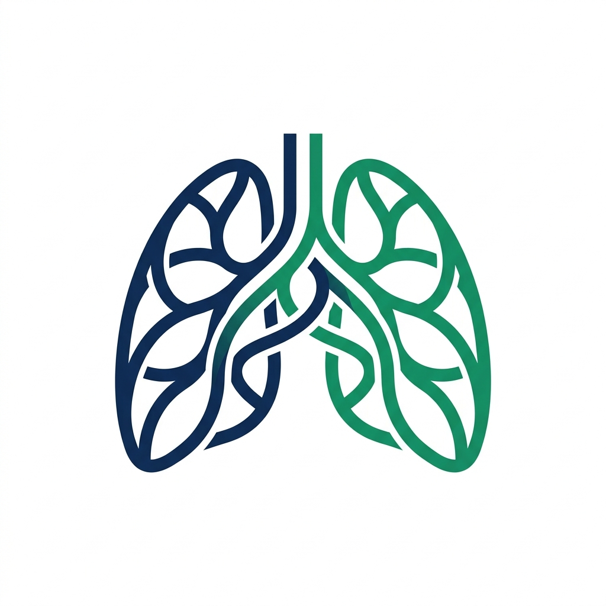
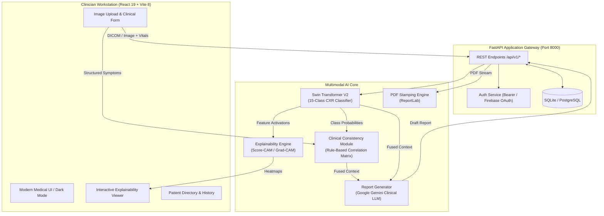

# CliniFusionX

<div align="center">



### Multimodal AI Clinical Decision Support Platform for Thoracic Radiology

[](https://github.com/VikramAdithya176/CliniFusionX/actions)
[](https://www.python.org/)
[](https://nodejs.org/)
[](https://fastapi.tiangolo.com/)
[](https://react.dev/)
[](https://pytorch.org/)
[](LICENSE)

*Synthesizing chest radiographs, clinical symptoms, laboratory markers, and deep visual explainability into validated radiological intelligence.*

</div>

---

## 📑 Table of Contents

- [Overview](#-overview)
- [Key Features](#-key-features)
- [System Architecture](#-system-architecture)
- [Pathology Coverage](#-pathology-coverage-15-classes)
- [Technology Stack](#-technology-stack)
- [Project Structure](#-project-structure)
- [Prerequisites](#-prerequisites)
- [Installation & Quick Start](#-installation--quick-start)
  - [Option A: Docker Compose (Recommended)](#option-a-docker-compose-recommended)
  - [Option B: Local Development Setup](#option-b-local-development-setup)
- [Environment Configuration](#-environment-configuration)
- [API Reference](#-api-reference)
- [Workstation Guide & Workflow](#-workstation-guide--workflow)
- [Clinical Safety & Research Disclaimer](#-clinical-safety--research-disclaimer)
- [Contributing & License](#-contributing--license)

---

## 🩺 Overview

**CliniFusionX** is an advanced multimodal AI clinical decision support system designed to assist healthcare professionals in thoracic radiograph interpretation. While standard medical computer vision models function as opaque black boxes that output raw probabilities, CliniFusionX bridges visual radiology with true clinical context:

1. **Vision-Language Synergy**: Simultaneously analyzes frontal chest radiographs alongside patient clinical history, reported symptoms, vital signs, and laboratory panels.
2. **Clinical Consistency Cross-Checking**: Verifies visual neural network predictions against a rule-based **Clinical Consistency Module (CCM)** to flag atypical, concordant, or discordant findings.
3. **Transparent Explainability**: Visualizes exact anatomical attention areas using **Score-CAM** and **Grad-CAM** saliency heatmaps with background generation and client-side caching.
4. **Structured Radiological Reporting**: Automates the draft generation of formal, 5-part radiological reports (Technique, Clinical Context, Findings, Impression, Recommendations) stamped with clinician credentials and exportable as high-resolution PDFs.
5. **Patient Directory & Audit Trail**: Organizes longitudinal scans under unique Medical Record Numbers (MRNs) with real-time sorting, filtering, and persistent database storage.

---

## ✨ Key Features

### 👁️ Swin Transformer V2 Vision Engine
- Leverages a hierarchical **Swin Transformer (Tiny Patch4 Window7 224)** architecture fine-tuned on the **NIH ChestX-ray14** benchmark.
- Shifted window self-attention computes multi-scale visual features sensitive to subtle opacities, pleural effusions, and interstitial patterns.
- Class-calibrated decision thresholds ensure balanced sensitivity and specificity across rare and common thoracic conditions.

### 🧠 Clinical Consistency Module (CCM)
- A clinical rule-based knowledge matrix correlating 15 thoracic diseases with canonical symptom profiles, vital abnormalities (hypoxemia, tachycardia, fever), and lab values (WBC, CRP, D-Dimer).
- Labels findings with clear clinical validation tags:
  - `High Consistency`: Strong alignment between radiograph pathology and patient vitals/symptoms.
  - `Atypical / Incidental`: Finding detected on image without expected acute symptoms.
  - `Symptom Discordance`: Symptoms suggestive of pathology not supported by the radiograph.

### 🔬 High-Fidelity Explainability (Score-CAM & Grad-CAM)
- **Gradient-free Score-CAM** eliminates noisy gradient artifacts to highlight true class-activation regions.
- Non-blocking background worker computes explainability maps asynchronously with live progress badges in the top navigation bar.
- Interactive heatmap opacity slider, color map controls, and one-click per-pathology visual toggles.

### 📋 Automated Structured Reports & PDF Export
- Generates clinical reports adhering to ACR (American College of Radiology) reporting guidelines using Google Gemini multimodal intelligence.
- Incorporates patient vitals, symptoms, top differential diagnoses, and clinician verification notes.
- One-click print-ready **Clinical PDF Exporter** stamped with the attending clinician's name, role, hospital department, and scan overlays.

### 👥 Patient Directory & Collision-Free MRNs
- Manages patient demographics with guaranteed-unique, collision-resistant **Medical Record Numbers (`MRN-XXXXXX`)**.
- Fast directory search by name or MRN with multi-parameter filtering:
  - **Sex Filter**: All, Male, Female, Other
  - **Scan Status**: All, With Scans, No Scans Yet
  - **Interactive Sorting**: Sort by Date (newest/oldest), Name (A-Z/Z-A), MRN, Age, or Scan Count with sort direction toggles and clickable column headers.

### 🔐 Clinician Profile & Workstation Security
- Role-based session authentication with Bearer token security.
- Integrated **Firebase Google OAuth** with server-side JWKS signature verification and clock-skew compensation.
- Dedicated **Doctor Profile Settings** allowing clinicians to update their full name, clinical title, and medical department, synchronizing live across the workstation without page reloads.

---

## 🏛️ System Architecture



---

## 🩻 Pathology Coverage (15 Classes)

CliniFusionX detects and differentiates 14 thoracic pathologies and normal findings:

| Pathology | Description | Clinical Indicators Monitored |
|-----------|-------------|-------------------------------|
| **Atelectasis** | Partial lung collapse or volume loss | Dyspnea, decreased breath sounds, hypoxemia |
| **Cardiomegaly** | Enlarged cardiac silhouette (CTR > 0.50) | Peripheral edema, orthopnea, elevated BNP |
| **Consolidation** | Alveolar airspaces filled with fluid/pus | Productive cough, bronchial breathing, fever |
| **Edema** | Pulmonary vascular congestion / fluid | Bilateral crackles, severe dyspnea, pink sputum |
| **Effusion** | Blunting of costophrenic angles (fluid) | Pleuritic pain, dullness to percussion, orthopnea |
| **Emphysema** | Hyperinflation and flattened diaphragms | Barrel chest, chronic dyspnea, wheezing |
| **Fibrosis** | Reticular opacities and parenchymal scarring | Dry cough, inspiratory crackles, finger clubbing |
| **Hernia** | Diaphragmatic visceral displacement | Epigastric fullness, postprandial distress |
| **Infiltration** | Ill-defined parenchymal density | Low-grade fever, systemic fatigue, mild cough |
| **Mass** | Lesion > 30 mm in diameter | Hemoptysis, unintentional weight loss, localized pain |
| **Nodule** | Discrete round lesion ≤ 30 mm | Often asymptomatic; smoking history tracking |
| **Pleural Thickening** | Apical cap or calcified pleural plaques | Asbestos exposure history, dull pain |
| **Pneumonia** | Infectious consolidation / air bronchograms | High fever, purulent sputum, elevated WBC/CRP |
| **Pneumothorax** | Visceral pleural line with absent lung markings | Sudden pleuritic chest pain, unilateral hyperresonance |
| **No Finding** | Clear lungs, normal mediastinum, intact diaphragms | Absence of acute cardiopulmonary abnormalities |

---

## 💻 Technology Stack

### Frontend
- **Framework**: React 19, TypeScript ~6.0, Vite 8
- **Styling**: Tailwind CSS, Lucide React icons
- **Data Visualization**: Recharts (interactive calibration charts & probability distributions)
- **Routing & State**: React Router DOM v7, Context API, responsive AppShell layout

### Backend
- **Web Framework**: FastAPI (high-concurrency ASGI)
- **Machine Learning**: PyTorch 2.1, Torchvision, TIMM (Swin Transformer V2)
- **Computer Vision**: OpenCV, Pillow (PIL), NumPy
- **Generative AI**: Google Gemini 1.5/2.0 (`google-generativeai`)
- **Document Generation**: ReportLab (vector-quality medical PDFs)
- **Database & ORM**: SQLAlchemy with SQLite (migratable to PostgreSQL)
- **Authentication**: JWT Bearer tokens, Firebase Admin SDK, PyJWKClient

---

## 📂 Project Structure

```
CliniFusionX/
├── backend/
│   ├── app.py                      # FastAPI application entrypoint and route handlers
│   ├── inference.py                # Swin Transformer V2 model loader and inference engine
│   ├── model.py                    # PyTorch Swin-B / Swin-T architecture wrapper
│   ├── ccm.py                      # Clinical Consistency Module (symptom & disease KB)
│   ├── explainability.py           # Grad-CAM and Score-CAM heatmap generators
│   ├── clinical_extractor.py       # Clinical text/document information extractor
│   ├── report_generator.py         # LLM-based structured clinical radiological reporter
│   ├── pdf_exporter.py             # Branded PDF generator with clinician signature stamps
│   ├── database.py                 # SQLAlchemy session and engine management
│   ├── models.py                   # ORM models (User, Patient, AnalysisRecord)
│   ├── config.json                 # Image preprocessing and model hyper-parameters
│   ├── labels.json                 # Pathology classification label definitions
│   ├── thresholds.json             # Calibrated per-disease decision cutoffs
│   ├── test_app.py                 # Backend unit & integration test suite
│   └── requirements.txt            # Python dependencies
│
├── frontend/
│   ├── src/
│   │   ├── routes/                 # Workstation views
│   │   │   ├── index.tsx           # Clinical dashboard & real-time telemetry
│   │   │   ├── new-analysis.tsx    # Upload radiograph, symptoms, vitals & patient selector
│   │   │   ├── results.tsx         # Multimodal findings, risk ranking & probability bars
│   │   │   ├── explainability.tsx  # Score-CAM heatmaps, opacity sliders & focus tools
│   │   │   ├── report.tsx          # Structured radiological report & PDF download
│   │   │   ├── patients.tsx        # Patient Directory with unique MRNs, sorting & filters
│   │   │   ├── history.tsx         # Longitudinal analysis archive & case review
│   │   │   ├── profile.tsx         # Doctor profile, credentials, and password settings
│   │   │   ├── settings.tsx        # Workstation preferences & privacy controls
│   │   │   └── login.tsx           # Clinician workstation login & Google OAuth
│   │   ├── components/             # Reusable UI components (AppShell, Toast, Modals)
│   │   └── services/               # API clients (authService, patientService, historyService)
│   ├── package.json
│   └── vite.config.ts
│
├── .github/workflows/
│   └── ci.yml                      # GitHub Actions CI (Backend tests, Node 22 build, Docker)
├── best_swin_chestxray14.pth       # Trained model weights (placed in root)
├── Dockerfile                      # Production multi-stage container build
├── docker-compose.yml              # Container orchestration with persistent volume
└── README.md
```

---

## 📦 Prerequisites

Ensure the following tools are installed on your workstation:

- **Docker & Docker Compose** (Recommended for turnkey deployment)
  *or for local manual execution:*
- **Python**: `3.10` or higher
- **Node.js**: `20.19.0+` or `22.x` (LTS recommended)
- **Google Gemini API Key**: Free or paid key from [Google AI Studio](https://aistudio.google.com/)
- *(Optional)* **NVIDIA GPU** with CUDA 11.8+ drivers for GPU-accelerated inference (runs automatically on CPU if GPU is absent).

---

## 🚀 Installation & Quick Start

### Option A: Docker Compose (Recommended)

1. **Clone the repository**:
   ```bash
   git clone https://github.com/VikramAdithya176/CliniFusionX.git
   cd CliniFusionX
   ```

2. **Configure your environment**:
   Copy the example environment file and insert your Gemini API Key:
   ```bash
   cp .env.example .env
   # Edit .env and set GEMINI_API_KEY=your_gemini_api_key
   ```

3. **Start the workstation**:
   ```bash
   docker compose up --build -d
   ```

4. **Access the application**:
   - Open your browser at: **`http://localhost:8000`**
   - Default credentials:
     - **Username**: `admin`
     - **Password**: `admin123`
     - *(Or click "Continue as Guest" to explore immediately)*

---

### Option B: Local Development Setup

#### 1. Backend Setup
```bash
# Navigate to the backend directory
cd backend

# Create and activate a virtual environment
python -m venv .venv
# On Windows:
.venv\Scripts\activate
# On Linux/macOS:
source .venv/bin/activate

# Install Python dependencies
pip install --upgrade pip
pip install -r requirements.txt

# Create your .env in the root directory with GEMINI_API_KEY
# Then start the FastAPI server
uvicorn app:app --reload --host 0.0.0.0 --port 8000
```

#### 2. Frontend Setup
In a new terminal window:
```bash
# Navigate to the frontend directory
cd frontend

# Install dependencies (requires Node 20.19+ or 22+)
npm install

# Start the Vite development server
npm run dev
```

The frontend will start at **`http://localhost:5173`** and proxy API calls to port `8000`.

---

## ⚙️ Environment Configuration

Configure the following variables in your `.env` file at the root of the project:

| Variable | Required | Default | Description |
|----------|:--------:|---------|-------------|
| `GEMINI_API_KEY` | **Yes** | — | Google Gemini API Key for report generation and clinical extraction |
| `ALLOWED_ORIGINS` | No | `http://localhost:5173,http://localhost:3000,http://localhost:8000` | Comma-separated CORS allowed origins |
| `ENABLE_DOCS` | No | `true` | Set to `false` in production to disable Swagger (`/docs`) |
| `SQLALCHEMY_DATABASE_URL` | No | `sqlite:///./clinifusion.db` | Database connection string (SQLite or PostgreSQL) |

---

## 🔌 API Reference

FastAPI automatically serves interactive Swagger API documentation at:
- **Swagger UI**: `http://localhost:8000/docs`
- **ReDoc**: `http://localhost:8000/redoc`

### Core Endpoints

#### Analysis & Vision
- `POST /api/v1/analyze` — Upload radiograph and optional clinical symptoms for multimodal inference.
- `POST /api/v1/explain` — Generate Score-CAM or Grad-CAM saliency heatmaps for a designated pathology.
- `POST /api/v1/explain/clear-cache` — Invalidate in-memory heatmap caches.

#### Clinical Records & PDF Export
- `GET /api/v1/history` — Fetch all analysis history records for the authenticated doctor.
- `POST /api/v1/history` — Save a structured analysis and report.
- `DELETE /api/v1/history/{record_id}` — Delete a specific clinical record.
- `POST /api/v1/export-pdf` — Generate and stream a branded clinical PDF report stamped with doctor credentials.

#### Patient Directory
- `GET /api/v1/patients` — List registered patients with demographics, created timestamps, and scan tallies.
- `POST /api/v1/patients` — Register a new patient with auto-generated unique MRN or update demographics.
- `DELETE /api/v1/patients/{mrn}` — Remove a patient from the directory.

#### Authentication & Profile
- `POST /api/v1/auth/login` — Sign in with username and password.
- `POST /api/v1/auth/register` — Register a new clinician account.
- `POST /api/v1/auth/google` — Authenticate via Firebase Google ID token exchange.
- `PUT /api/v1/auth/profile` — Update clinician full name, role/title, and department.
- `POST /api/v1/auth/change-password` — Update workstation account password.

#### System Health & Knowledge Base
- `GET /api/v1/health` — Check server status, PyTorch device (CUDA/CPU), model readiness, and checkpoint state.
- `GET /api/v1/kb-diseases` — Retrieve the full clinical symptom and risk factor knowledge base.

---

## 🧭 Workstation Guide & Workflow

1. **Patient Registration & Selection**:
   - Access **Patient Directory** to view patients, sort by Date, Name, MRN, or Scans, or filter by sex/scan status.
   - Click **Register Patient** to add demographics with a guaranteed-unique auto-generated MRN.
2. **Conduct New Analysis**:
   - Navigate to **New Analysis**, select an existing patient or input a new profile.
   - Upload a frontal chest radiograph (JPEG, PNG, WebP, DICOM-converted).
   - Enter patient vitals (SpO2, Heart Rate, Temperature) and select presenting symptoms.
   - Click **Run Multimodal Analysis**.
3. **Review Diagnostic Results**:
   - Examine the 15-class probability distribution, primary finding, and calibrated risk assessment.
   - Review Clinical Consistency tags to check whether patient symptoms match radiograph evidence.
4. **Inspect Explainability**:
   - Open the **Explainability** tab to inspect Score-CAM activation heatmaps.
   - Adjust overlay opacity and select different differential diagnoses to verify anatomical focus.
5. **Generate & Export Clinical Report**:
   - Review the AI-synthesized 5-part radiological report.
   - Click **Export Clinical PDF** to download a formatted, clinician-stamped diagnostic document.

---

## ⚠️ Clinical Safety & Research Disclaimer

> [!IMPORTANT]
> **CliniFusionX is an academic research prototype and clinical decision support system.**
> - It is **not** an unsupervised medical device and has not received FDA 510(k), CE mark, or international regulatory clearance for independent primary diagnosis.
> - All algorithmic predictions, consistency checks, heatmaps, and report drafts must be reviewed, verified, and validated by a licensed physician or board-certified radiologist prior to clinical intervention.

---

## 📄 Contributing & License

Contributions are welcome! Please submit issues or pull requests to improve model accuracy, clinical guidelines, or user interface capabilities.

Distributed under the **MIT License**. See `LICENSE` for details.
